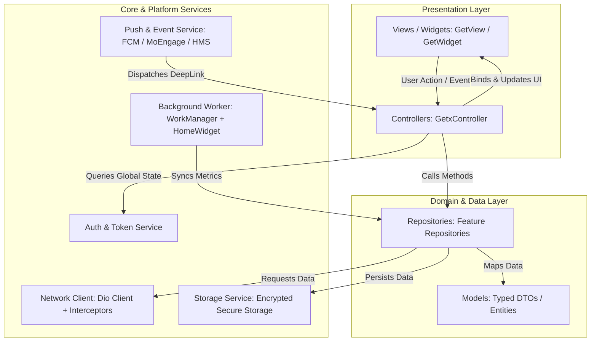
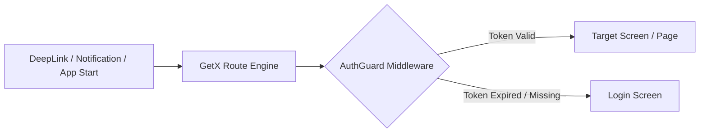
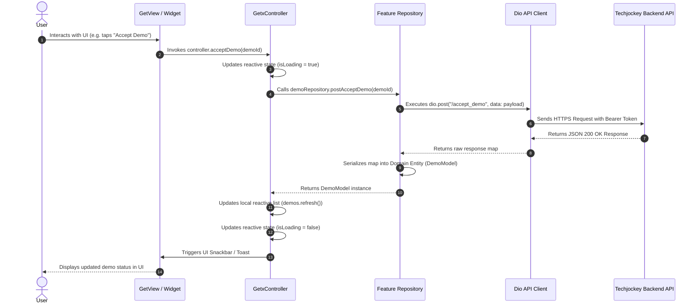

# Architecture Design Document: Techjockey Vendor Partner App

## 1. Executive Summary & Architectural Vision

The **Techjockey Vendor Partner App** (`vendor_app`) is an enterprise-grade mobile application designed for software vendors, original equipment manufacturers (OEMs), and SaaS creators operating on the Techjockey marketplace ecosystem. The application enables vendors to track inbound purchase leads, schedule and manage software demonstrations, monitor customer orders and license provisioning, inspect real-time product performance analytics, and manage multiple vendor brands.

This codebase modernizes the legacy implementation (`vendorapp`) into a robust, scalable, and testable **Model-View-Controller (MVC) architecture powered by GetX**. 

### 1.1 Problems in Legacy Architecture Solved in Modern MVC + GetX
* **Elimination of Global Mutable State**: Removed anti-patterns centered around `global.dart` where singleton instances, raw tokens, and mutable user records were globally exposed.
* **Separation of Concerns**: Decoupled presentation logic, network interactions, and state persistence from UI widgets.
* **Unified State Management**: Replaced the fragmented combination of `setState`, raw `ChangeNotifier`/`Provider`, and unmanaged `GetBuilder` with reactive `GetxController` observables (`Rx<T>`, `Obx`).
* **Standardized Networking**: Replaced fragmented `http` and un-intercepted `Dio` calls with a centralized, interceptor-driven HTTP client utilizing custom request interceptors, token refreshers, and typed DTO serializers.
* **Deterministic Dependency Injection**: Replaced manual instantiation inside `initState()` with route-driven `Bindings` using `Get.lazyPut()`.

---

## 2. High-Level System Architecture

The application adopts a **Feature-Driven MVC Architecture** layered with clean separation principles. Each functional business vertical is treated as an isolated domain containing its own Models, Views, Controllers, and Service/Repository bindings.



---

## 3. Core Architectural Components

### 3.1 The Model Layer
Models represent business entities and data transfer objects (DTOs). They are immutable, strictly typed, and completely decoupled from Flutter UI libraries.
* Every model defines explicit serialization methods (`fromJson`, `toJson`).
* Models leverage pure Dart primitives and enforce non-nullable contracts with default fallbacks to prevent runtime null crashes when parsing dynamic REST responses.

```dart
// Example: lib/core/models/lead_model.dart
class LeadModel {
  final String id;
  final String buyerName;
  final String companyName;
  final String contactNumber;
  final String email;
  final String status;
  final double dealValue;
  final DateTime createdAt;

  const LeadModel({
    required this.id,
    required this.buyerName,
    required this.companyName,
    required this.contactNumber,
    required this.email,
    required this.status,
    required this.dealValue,
    required this.createdAt,
  });

  factory LeadModel.fromJson(Map<String, dynamic> json) {
    return LeadModel(
      id: json['id']?.toString() ?? '',
      buyerName: json['buyer_name'] ?? 'Unknown Buyer',
      companyName: json['company_name'] ?? 'Individual',
      contactNumber: json['contact_number'] ?? '',
      email: json['email'] ?? '',
      status: json['status'] ?? 'NEW',
      dealValue: (json['deal_value'] as num?)?.toDouble() ?? 0.0,
      createdAt: json['created_at'] != null 
          ? DateTime.tryParse(json['created_at']) ?? DateTime.now()
          : DateTime.now(),
    );
  }

  Map<String, dynamic> toJson() => {
    'id': id,
    'buyer_name': buyerName,
    'company_name': companyName,
    'contact_number': contactNumber,
    'email': email,
    'status': status,
    'deal_value': dealValue,
    'created_at': createdAt.toIso8601String(),
  };
}
```

### 3.2 The View Layer
Views are strictly declarative user interfaces built using `GetView<TController>` or `GetWidget<TController>`.
* **Zero Business Logic**: Views do not trigger direct network requests, parse raw JSON, or mutate persistent state directly.
* **Reactive Rendering**: Uses `Obx(() => ...)` only around the exact UI nodes that require rebuilding when reactive state changes.
* **Component Extraction**: Screens are broken down into self-contained widgets to maintain widget tree depth below 4 levels.

```dart
// Example: lib/features/leads/views/lead_list_view.dart
import 'package:flutter/material.dart';
import 'package:get/get.dart';
import '../controllers/lead_controller.dart';
import '../widgets/lead_card_widget.dart';

class LeadListView extends GetView<LeadController> {
  const LeadListView({super.key});

  @override
  Widget build(BuildContext context) {
    return Scaffold(
      appBar: AppBar(
        title: const Text('Deal Opportunities & Leads'),
        actions: [
          IconButton(
            icon: const Icon(Icons.filter_list),
            onPressed: controller.openFilterSheet,
          ),
        ],
      ),
      body: Obx(() {
        if (controller.isLoading.value) {
          return const Center(child: CircularProgressIndicator());
        }

        if (controller.leads.isEmpty) {
          return const Center(child: Text('No active leads found for this period'));
        }

        return RefreshIndicator(
          onRefresh: controller.refreshLeads,
          child: ListView.builder(
            itemCount: controller.leads.length,
            itemBuilder: (context, index) {
              final lead = controller.leads[index];
              return LeadCardWidget(
                lead: lead,
                onTap: () => controller.navigateToDetail(lead.id),
              );
            },
          ),
        );
      }),
    );
  }
}
```

### 3.3 The Controller Layer
Controllers inherit from `GetxController` and manage state, business rules, API interactions, and user feedback.
* **Lifecycle Awareness**: Implements `onInit()` for parameter initialization, `onReady()` for initial remote calls, and `onClose()` for stream and subscription cleanup.
* **Reactive State Properties**: Exposes observable fields using `.obs` primitives (`RxBool`, `RxString`, `RxList<T>`).
* **Debounced Event Workers**: Employs `debounce()` or `interval()` for search queries, scroll position tracking, and filter changes.

```dart
// Example: lib/features/leads/controllers/lead_controller.dart
import 'package:get/get.dart';
import '../models/lead_model.dart';
import '../repositories/lead_repository.dart';

class LeadController extends GetxController {
  final LeadRepository _repository;
  LeadController(this._repository);

  final RxList<LeadModel> leads = <LeadModel>[].obs;
  final RxBool isLoading = false.obs;
  final RxString selectedFilter = 'HOT'.obs;
  final RxString searchQuery = ''.obs;

  @override
  void onInit() {
    super.onInit();
    // Debounce search updates to prevent API flooding
    debounce(searchQuery, (_) => fetchLeads(), time: const Duration(milliseconds: 400));
  }

  @override
  void onReady() {
    super.onReady();
    fetchLeads();
  }

  Future<void> fetchLeads() async {
    try {
      isLoading.value = true;
      final results = await _repository.getLeads(
        status: selectedFilter.value,
        query: searchQuery.value,
      );
      leads.assignAll(results);
    } catch (e) {
      Get.snackbar('Error', 'Unable to load leads: ${e.toString()}');
    } finally {
      isLoading.value = false;
    }
  }

  Future<void> refreshLeads() async => await fetchLeads();

  void navigateToDetail(String leadId) {
    Get.toNamed('/leads/detail', parameters: {'id': leadId});
  }

  void openFilterSheet() {
    // Show bottom sheet implementation
  }
}
```

---

## 4. State Management & Dependency Injection

### 4.1 Dependency Injection Strategy
The project leverages GetX Route-Level **Bindings** combined with long-lived **GetxService** instances for global singletons.

| Scope | Mechanism | Usage |
| :--- | :--- | :--- |
| **Global Long-Lived** | `Get.putAsync<T>(() => T.init())` | Encrypted Storage, Global AuthService, Push Notification Client, Dio Network Engine |
| **Feature / Route-Level** | `Get.lazyPut<T>(() => T())` inside `Bindings` | View-specific controllers instantiated only when navigating into the route and reclaimed on route pop |

```dart
// Example: lib/features/leads/bindings/lead_binding.dart
import 'package:get/get.dart';
import '../controllers/lead_controller.dart';
import '../repositories/lead_repository.dart';
import '../../../core/network/api_client.dart';

class LeadBinding extends Bindings {
  @override
  void dependencies() {
    Get.lazyPut<LeadRepository>(() => LeadRepository(Get.find<ApiClient>()));
    Get.lazyPut<LeadController>(() => LeadController(Get.find<LeadRepository>()));
  }
}
```

---

## 5. Routing & Deep-Linking Architecture

The routing system uses declarative named routes configured via `GetPage` definitions, protected by navigation middlewares.



### 5.1 Route Definition Table

| Route Name | Path | Binding Class | Middleware Guard |
| :--- | :--- | :--- | :--- |
| **Splash** | `/` | `SplashBinding` | None |
| **Login** | `/auth/login` | `AuthBinding` | `UnauthenticatedOnlyGuard` |
| **Dashboard** | `/dashboard` | `DashboardBinding` | `AuthGuard` |
| **Leads** | `/leads` | `LeadBinding` | `AuthGuard` |
| **Lead Detail** | `/leads/detail` | `LeadDetailBinding` | `AuthGuard` |
| **Demo Pipeline** | `/demos` | `DemoBinding` | `AuthGuard` |
| **Order Tracking**| `/orders` | `OrderTrackingBinding` | `AuthGuard` |
| **Profile** | `/profile` | `ProfileBinding` | `AuthGuard` |

### 5.2 Deep-Link Routing Mechanism
The app captures deep links formatted as `https://esellerhub.techjockey.com/<action>?<query>` via `app_links`:
* `calldetail?leadid=XYZ` -> Routes directly to `/leads/detail?id=XYZ`.
* `demodetail?demoid=ABC` -> Routes directly to `/demos/detail?id=ABC`.
* `orders?orderid=123` -> Routes directly to `/orders/detail?id=123`.

---

## 6. Project Directory Structure

```
/Users/siddhantkumar/StudioProjects/vendor_app/
├── android/                        # Android platform project with flavors & ProGuard
├── ios/                            # iOS platform project with entitlements & Runner
├── test/                           # Test suite (Unit, Widget, Mocks)
│   ├── unit/                       # Controller & Repository unit tests
│   ├── widget/                     # UI and Screen widget tests
│   └── mocks/                      # Mocktail stubs & test fakes
├── assets/                         # Static icons, logos, audio, fonts
│   ├── fonts/
│   ├── icons/
│   └── images/
└── lib/
    ├── main.dart                   # Application entry point & runtime initialization
    ├── core/                       # Shared platform primitives & singleton services
    │   ├── constants/              # API endpoints, design tokens, asset keys
    │   ├── network/                # Dio client, interceptors, error parsers
    │   ├── services/               # GetxServices: SecureStorage, Auth, Push, Workmanager
    │   ├── theme/                  # Color palette, Typography, AppTheme
    │   ├── utils/                  # Formatters, DateTime helpers, validators
    │   └── widgets/                # Reusable design system components (buttons, shimmers)
    ├── routes/                     # Centralized navigation registry
    │   ├── app_pages.dart          # List of GetPage definitions
    │   ├── app_routes.dart         # Constant route names
    │   └── middlewares/            # AuthGuard, ForceUpdateGuard
    └── features/                   # Business domain modules (MVC)
        ├── auth/                   # Authentication & login module
        │   ├── bindings/
        │   ├── controllers/
        │   ├── models/
        │   ├── repositories/
        │   └── views/
        ├── dashboard/              # Metrics, charts, health score, home tab
        │   ├── bindings/
        │   ├── controllers/
        │   ├── models/
        │   ├── repositories/
        │   └── views/
        ├── leads/                  # All Leads, filter, details, audio calls
        │   ├── bindings/
        │   ├── controllers/
        │   ├── models/
        │   ├── repositories/
        │   ├── views/
        │   └── widgets/
        ├── demos/                  # Product demo schedules, reschedules, video link
        │   ├── bindings/
        │   ├── controllers/
        │   ├── models/
        │   ├── repositories/
        │   └── views/
        ├── orders/                 # Order tracking, license upload, PDF viewers
        │   ├── bindings/
        │   ├── controllers/
        │   ├── models/
        │   ├── repositories/
        │   └── views/
        └── profile/                # Brand management, profile settings, credentials
            ├── bindings/
            ├── controllers/
            ├── models/
            ├── repositories/
            └── views/
```

---

## 7. Data Flow & Communication Lifecycle



