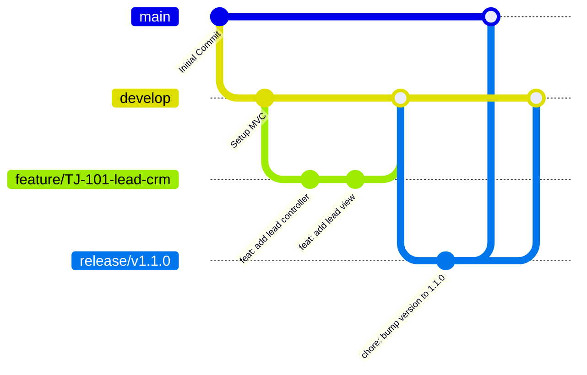

# Engineering Conventions & Coding Standards: Techjockey Vendor App

## 1. Static Analysis & Linter Rules

The project strictly follows the official Dart and Flutter style guides enforced by `flutter_lints` alongside enterprise production rules configured in `analysis_options.yaml`.

### 1.1 `analysis_options.yaml` Configuration

```yaml
include: package:flutter_lints/flutter.yaml

analyzer:
  language:
    strict-casts: true
    strict-inference: true
    strict-raw-types: true
  errors:
    missing_required_param: error
    missing_return: error
    todo: ignore
    invalid_annotation_target: ignore
  exclude:
    - "**/*.g.dart"
    - "**/*.freezed.dart"
    - "build/**"

linter:
  rules:
    - always_declare_return_types
    - avoid_empty_else
    - avoid_print
    - avoid_relative_lib_imports
    - avoid_shadowing_type_parameters
    - avoid_types_as_parameter_names
    - avoid_unnecessary_containers
    - avoid_unused_constructor_parameters
    - await_only_futures
    - camel_case_extensions
    - camel_case_types
    - cancel_subscriptions
    - close_sinks
    - curly_braces_in_flow_control_structures
    - empty_catches
    - file_names
    - hash_and_equals
    - no_duplicate_case_values
    - prefer_const_constructors
    - prefer_const_declarations
    - prefer_final_fields
    - prefer_is_empty
    - prefer_is_not_empty
    - prefer_iterable_whereType
    - prefer_single_quotes
    - slash_for_doc_comments
    - unawaited_futures
    - unnecessary_const
    - unnecessary_new
    - unnecessary_null_aware_assignments
    - unnecessary_nullable_for_final_variable_declarations
    - unnecessary_string_interpolations
    - use_build_context_synchronously
    - use_key_in_widget_constructors
    - valid_regexps
```

### 1.2 Verification Commands
Run static analysis from the project root:

```bash
# Run static analysis
flutter analyze

# Automatically apply safe fixes for style and deprecations
dart fix --apply
```

---

## 2. Naming Conventions

Consistency across files, types, and variables ensures immediate readability and prevents circular import collisions.

| Artifact | Convention | Pattern / Example | Notes |
| :--- | :--- | :--- | :--- |
| **Dart Files** | `snake_case.dart` | `lead_detail_controller.dart`, `order_tracking_view.dart` | Suffix indicates role (`_controller`, `_view`, `_model`, `_binding`, `_repository`). |
| **Classes / Types** | `UpperCamelCase` | `LeadDetailController`, `OrderTrackingView`, `OemPlanModel` | Match file name semantics. |
| **Widgets** | `UpperCamelCase` | `LeadCardWidget`, `CustomButtonWidget` | Suffix with `Widget` or `View` depending on scope. |
| **Controllers** | `UpperCamelCase` | `LeadController`, `DashboardController` | Must extend `GetxController`. Suffix with `Controller`. |
| **Bindings** | `UpperCamelCase` | `LeadBinding`, `AuthBinding` | Must implement `Bindings`. Suffix with `Binding`. |
| **Repositories** | `UpperCamelCase` | `LeadRepository`, `OrderRepository` | Suffix with `Repository`. |
| **Models / DTOs** | `UpperCamelCase` | `LeadModel`, `OemPlanModel` | Suffix with `Model`. Avoid generic suffixes like `ModelClass`. |
| **Functions / Methods** | `lowerCamelCase` | `fetchLeadDetails()`, `onFilterChanged()` | Start with an action verb. |
| **Local Variables** | `lowerCamelCase` | `isLoading`, `leadItem` | Clear, self-documenting naming. |
| **Private Fields** | `_lowerCamelCase` | `_apiClient`, `_token` | Prefix with an underscore. |
| **Constants** | `lowerCamelCase` | `kDefaultPadding = 16.0`, `apiBaseUrl` | Dart standard style (avoid `SCREAMING_SNAKE_CASE` unless matching remote config keys). |
| **Rx Observables** | `lowerCamelCase` | `final RxBool isLoading = false.obs;` | Use explicit typing on Rx wrappers. |

---

## 3. Widget Design Guidelines

### 3.1 Prefer `const` Constructors
Every stateless or configuration widget must declare a `const` constructor where possible. This prevents unnecessary widget rebuilds during parent tree reconciliations.

```dart
// CORRECT
const LeadStatusBadge(status: 'HOT');

// INCORRECT
LeadStatusBadge(status: 'HOT');
```

### 3.2 Composition Over Deep Nesting
Never nest widgets deeper than **4 indentation levels** within a single build method. Extract logical presentation clusters into private sub-methods or standalone components.

```dart
// CORRECT: Clean composition
class LeadCardWidget extends StatelessWidget {
  final LeadModel lead;
  final VoidCallback onTap;

  const LeadCardWidget({
    super.key,
    required this.lead,
    required this.onTap,
  });

  @override
  Widget build(BuildContext context) {
    return Card(
      margin: const EdgeInsets.symmetric(horizontal: 16, vertical: 8),
      child: InkWell(
        onTap: onTap,
        child: Padding(
          padding: const EdgeInsets.all(16),
          child: Column(
            crossAxisAlignment: CrossAxisAlignment.start,
            children: [
              _buildHeader(context),
              const SizedBox(height: 12),
              _buildBuyerMetadata(context),
              const SizedBox(height: 12),
              _buildFooterActions(context),
            ],
          ),
        ),
      ),
    );
  }

  Widget _buildHeader(BuildContext context) {
    return Row(
      mainAxisAlignment: MainAxisAlignment.spaceBetween,
      children: [
        Text(lead.buyerName, style: Theme.of(context).textTheme.titleMedium),
        LeadBadgeWidget(status: lead.status),
      ],
    );
  }

  Widget _buildBuyerMetadata(BuildContext context) {
    return Text(lead.companyName, style: Theme.of(context).textTheme.bodyMedium);
  }

  Widget _buildFooterActions(BuildContext context) {
    return Row(
      children: [
        Icon(Icons.calendar_today, size: 16, color: Colors.grey[600]),
        const SizedBox(width: 6),
        Text(lead.createdAtFormatted),
      ],
    );
  }
}
```

### 3.3 Text Scale Clamping
To prevent interface breakage when users configure extreme font sizes in accessibility settings, clamp the font scale factor globally in `GetMaterialApp`:

```dart
// In main.dart
GetMaterialApp(
  builder: (context, child) {
    final mediaQuery = MediaQuery.of(context);
    final clampedScale = mediaQuery.textScaler.clamp(
      minScaleFactor: 0.85,
      maxScaleFactor: 1.15,
    );
    return MediaQuery(
      data: mediaQuery.copyWith(textScaler: clampedScale),
      child: child!,
    );
  },
);
```

---

## 4. Git Workflow & Version Control Standards

### 4.1 Branching Strategy (Trunk-Based with Features)



* `main`: Production-ready code matching deployed app versions.
* `develop`: Integration branch for sprint features.
* `feature/<ticket-id>-<short-description>`: Feature development (e.g. `feature/TJ-242-order-license-upload`).
* `fix/<ticket-id>-<short-description>`: Bug fixes (e.g. `fix/TJ-305-demo-reschedule-crash`).
* `chore/<description>`: Maintenance tasks, dependency bumps (e.g. `chore/upgrade-flutter-3`).

### 4.2 Conventional Commit Messages
Commit messages must strictly follow the Conventional Commits specification:

```
<type>(<scope>): <short description in present tense>

[optional body explaining context and rationale]

[optional footer: Fixes TJ-123]
```

#### Commit Types:
* `feat`: A new user-facing capability or screen.
* `fix`: A bug fix in existing functionality.
* `refactor`: Code reorganization without functional changes.
* `perf`: Performance improvements.
* `chore`: Build scripts, gradle updates, dependency bumps.
* `docs`: Documentation updates.
* `test`: Adding or adjusting unit, widget, or integration tests.

#### Example:
```
feat(leads): add time-slot reschedule reason selector

- Introduce DemoRescheduleReasonModel
- Connect controller to /demo_reschedule_reason endpoint
- Add pop-up modal with radio validation

Fixes TJ-412
```

---

## 5. Pull Request (PR) Review Checklist

Prior to approving any pull request, reviewers must verify each item in this checklist:

- [ ] **Static Analysis**: `flutter analyze` runs with 0 errors and 0 warnings.
- [ ] **Tests Pass**: `flutter test` executes successfully. New business logic includes unit tests with at least 80% coverage.
- [ ] **Architecture Adherence**: Code strictly adheres to MVC + GetX boundaries. No direct HTTP calls inside widgets or views.
- [ ] **No Hardcoded Secrets**: No API keys, tokens, or plaintext URLs hardcoded in source files.
- [ ] **Null Safety**: No reckless use of force unwraps (`!`). All nullability handled via fallback operators (`??`) or conditional checks.
- [ ] **Resource Disposal**: All streams, controllers, listeners, or timers created outside GetX are disposed cleanly.
- [ ] **UI Responsiveness**: Tested on small screens (iPhone SE / 360dp Android) and large devices without layout overflows.
- [ ] **Localization & Strings**: UI text is structured for internationalization without magic strings.

