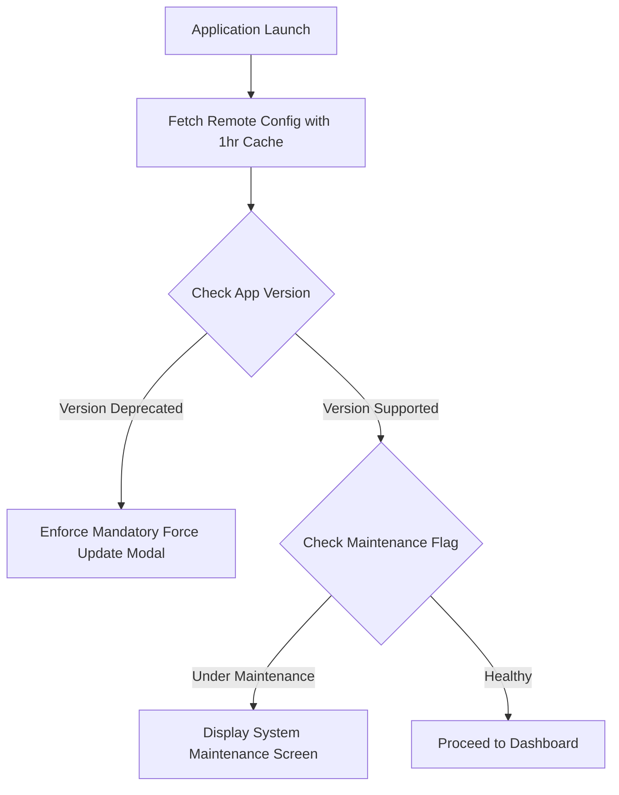

# Deployment & Release Engineering Guide: Techjockey Vendor App

## 1. Environment Flavors & Configuration

The application supports three operational environments: **Development (dev)**, **Staging (staging)**, and **Production (prod)**.

### 1.1 Environment Matrix

| Flavor | Target Audience | Backend Base URL (`BASE_URL`) | Deep Link Scheme | Package / Bundle ID |
| :--- | :--- | :--- | :--- | :--- |
| **dev** | Internal Engineers | `https://beta-api.techjockey.com/vendor/` | `tjpartner-dev://` | `com.vendor.space.dev` |
| **staging** | QA & Product UAT | `https://staging-api.techjockey.com/vendor/` | `tjpartner-staging://`| `com.vendor.space.staging` |
| **prod** | Public Marketplace | `https://esellerhub.techjockey.com/api/` | `https://esellerhub.techjockey.com` | `com.vendor.space` |

### 1.2 Configuration via `--dart-define-from-file`
Instead of committing plaintext `.env` files, environment values are injected at build time using JSON files ignored by git.

```json
// Example: config/env.prod.json
{
  "ENVIRONMENT": "production",
  "BASE_URL": "https://esellerhub.techjockey.com/api/",
  "BASE_URL_WWW": "https://esellerhub.techjockey.com/",
  "MOENGAGE_APP_ID": "TECHJOCKEY_MOE_PROD_KEY",
  "ENABLE_LOGGING": false
}
```

```dart
// lib/core/constants/app_config.dart
abstract class AppConfig {
  static const String environment = String.fromEnvironment('ENVIRONMENT', defaultValue: 'dev');
  static const String baseUrl = String.fromEnvironment('BASE_URL');
  static const String moengageAppId = String.fromEnvironment('MOENGAGE_APP_ID');
  static const bool enableLogging = bool.fromEnvironment('ENABLE_LOGGING', defaultValue: false);
}
```

---

## 2. Android Release Setup

### 2.1 Keystore Management
Generate a secure production keystore using Java `keytool`:

```bash
keytool -genkey -v -keystore tj_upload_keystore.jks \
  -alias tj_upload_key -keyalg RSA -keysize 2048 -validity 10000
```

Create `android/key.properties` (never commit this file to version control):

```properties
storePassword=SECURE_STORE_PASSWORD_HERE
keyPassword=SECURE_KEY_PASSWORD_HERE
keyAlias=tj_upload_key
storeFile=/absolute/path/to/tj_upload_keystore.jks
```

### 2.2 Gradle Signing & ProGuard Configuration
In `android/app/build.gradle`:

```groovy
def keystoreProperties = new Properties()
def keystorePropertiesFile = rootProject.file('key.properties')
if (keystorePropertiesFile.exists()) {
    keystoreProperties.load(new FileInputStream(keystorePropertiesFile))
}

android {
    namespace 'com.vendor.space'
    compileSdkVersion 36

    defaultConfig {
        applicationId "com.vendor.space"
        minSdkVersion 21
        targetSdkVersion 36
        versionCode flutterVersionCode.toInteger()
        versionName flutterVersionName
        multiDexEnabled true
    }

    signingConfigs {
        release {
            keyAlias keystoreProperties['keyAlias']
            keyPassword keystoreProperties['keyPassword']
            storeFile keystoreProperties['storeFile'] ? file(keystoreProperties['storeFile']) : null
            storePassword keystoreProperties['storePassword']
        }
    }

    buildTypes {
        release {
            signingConfig signingConfigs.release
            minifyEnabled true
            shrinkResources true
            proguardFiles getDefaultProguardFile('proguard-android-optimize.txt'), 'proguard-rules.pro'
        }
    }
}
```

### 2.3 ProGuard / R8 Rules (`android/app/proguard-rules.pro`)

```proguard
# Flutter Engine & Framework
-keep class io.flutter.app.** { *; }
-keep class io.flutter.plugin.** { *; }
-keep class io.flutter.util.** { *; }
-keep class io.flutter.view.** { *; }
-keep class io.flutter.** { *; }
-keep class io.flutter.plugins.** { *; }

# Workmanager & HomeWidget
-keep class androidx.work.** { *; }
-keep class es.antonborri.home_widget.** { *; }

# MoEngage SDK
-keep class com.moengage.** { *; }
-dontwarn com.moengage.**

# Firebase & Google Services
-keep class com.google.firebase.** { *; }
-dontwarn com.google.firebase.**

# Models Serialization
-keepclassmembers class * {
    *** fromJson(...);
    *** toJson(...);
}
```

### 2.4 Android Build Command
Compile an optimized Android App Bundle (AAB):

```bash
flutter build appbundle \
  --release \
  --dart-define-from-file=config/env.prod.json
```

---

## 3. iOS Release Setup

### 3.1 Certificates, Identifiers & Provisioning
* **App Identifier**: `com.vendor.space`
* **App Groups**: `group.com.vendor.spacecaps` (required for home screen widget data sharing between app and widget extension)
* **Associated Domains**: `applinks:esellerhub.techjockey.com`

### 3.2 Permission Rationale Keys (`ios/Runner/Info.plist`)

```xml
<key>NSCameraUsageDescription</key>
<string>Techjockey Vendor App requires access to the camera to upload profile documents and verify software product assets.</string>

<key>NSPhotoLibraryUsageDescription</key>
<string>Techjockey Vendor App requires access to the photo library to upload order license certificates and profile imagery.</string>

<key>NSMicrophoneUsageDescription</key>
<string>Techjockey Vendor App requires microphone access to record audio messages and feedback notes for buyer deals.</string>

<key>UIBackgroundModes</key>
<array>
    <string>fetch</string>
    <string>remote-notification</string>
</array>
```

### 3.3 iOS Build & Archive Command
Compile and export an IPA ready for TestFlight / App Store:

```bash
flutter build ipa \
  --release \
  --dart-define-from-file=config/env.prod.json \
  --export-options-plist=ios/ExportOptions.plist
```

---

## 4. Continuous Integration & Continuous Delivery (CI/CD)

The following GitHub Actions workflow automates static analysis, testing, and production artifact builds:

```yaml
# .github/workflows/deploy.yml
name: Flutter CI/CD Pipeline

on:
  push:
    branches: [ main, develop ]
  pull_request:
    branches: [ main, develop ]

jobs:
  analyze_and_test:
    name: Lint, Analyze & Unit Test
    runs-on: ubuntu-latest
    steps:
      - name: Checkout Code
        uses: actions/checkout@v4

      - name: Setup Java
        uses: actions/setup-java@v4
        with:
          distribution: 'zulu'
          java-version: '17'

      - name: Setup Flutter SDK
        uses: subosito/flutter-action@v2
        with:
          flutter-version: '3.29.0'
          channel: 'stable'
          cache: true

      - name: Install Dependencies
        run: flutter pub get

      - name: Static Analysis
        run: flutter analyze

      - name: Run Unit Tests with Coverage
        run: flutter test --coverage

      - name: Upload Test Coverage Artifact
        uses: actions/upload-artifact@v4
        with:
          name: lcov-report
          path: coverage/lcov.info

  build_android:
    name: Build Android App Bundle (AAB)
    needs: analyze_and_test
    if: github.ref == 'refs/heads/main'
    runs-on: ubuntu-latest
    steps:
      - uses: actions/checkout@v4

      - name: Setup Java
        uses: actions/setup-java@v4
        with:
          distribution: 'zulu'
          java-version: '17'

      - uses: subosito/flutter-action@v2
        with:
          flutter-version: '3.29.0'
          channel: 'stable'

      - name: Decode Android Keystore
        run: echo "${{ secrets.ANDROID_KEYSTORE_BASE64 }}" | base64 --decode > android/app/tj_upload_keystore.jks

      - name: Create key.properties
        run: |
          echo "storePassword=${{ secrets.KEYSTORE_STORE_PASSWORD }}" > android/key.properties
          echo "keyPassword=${{ secrets.KEYSTORE_KEY_PASSWORD }}" >> android/key.properties
          echo "keyAlias=${{ secrets.KEYSTORE_ALIAS }}" >> android/key.properties
          echo "storeFile=tj_upload_keystore.jks" >> android/key.properties

      - name: Create Production Env File
        run: echo "${{ secrets.ENV_PROD_JSON }}" > config/env.prod.json

      - name: Build Production AAB
        run: flutter build appbundle --release --dart-define-from-file=config/env.prod.json

      - name: Upload Artifact
        uses: actions/upload-artifact@v4
        with:
          name: app-release.aab
          path: build/app/outputs/bundle/release/app-release.aab
```

---

## 5. Remote Configuration & Over-The-Air (OTA) Updates

### 5.1 Remote Config Architecture
The application integrates Firebase Remote Config to control dynamic runtime parameters without requiring App Store or Play Store resubmissions.



### 5.2 Key Remote Config Parameters

| Key | Type | Default Value | Description |
| :--- | :--- | :--- | :--- |
| `min_supported_version` | String | `3.1.7` | Minimum app version required to connect to APIs. Triggers force update if current < minimum. |
| `is_maintenance_mode` | Boolean| `false` | When true, renders a global maintenance notice and suppresses outgoing API queries. |
| `demo_reschedule_window_days` | Number | `7` | Maximum days into the future a vendor can reschedule a buyer demo. |
| `enable_widget_background_sync`| Boolean| `true` | Toggles WorkManager hourly background sync task for OS home widgets. |

