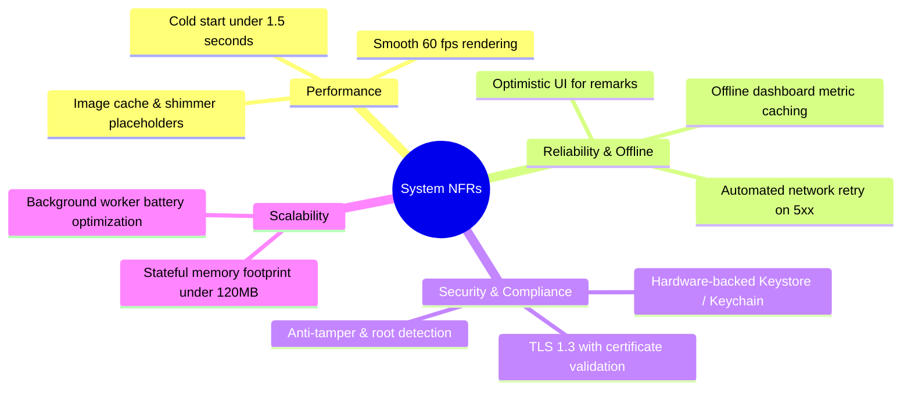

# Product Requirements Document (PRD): Techjockey Vendor Partner App

## 1. Product Overview & Executive Summary

The **Techjockey Vendor Partner App** (`Tj Partner App` / `vendor_app`) is an enterprise B2B mobile portal built for software developers, independent software vendors (ISVs), original equipment manufacturers (OEMs), and enterprise SaaS resellers registered on the Techjockey software marketplace. 

The application serves as the primary operational console for vendors to manage inbound commercial leads, conduct scheduled product demonstrations, fulfill customer orders, verify license provisioning, track product sales analytics, and manage multi-brand marketplace catalogs in real time.

### 1.1 Core Value Proposition
* **Instant Buyer Lead Conversion**: Immediate push notification and SMS/WhatsApp integration when high-intent B2B buyers request quotations or demos on Techjockey.com.
* **Unified Pipeline Transparency**: Visibility into lead temperature (Hot, Warm, Cold), demo scheduling, and order fulfillment workflows.
* **Streamlined License Fulfillments**: Rapid document/license dispatch and invoice PDF tracking, reducing order processing turnaround from days to minutes.
* **Real-Time Performance Diagnostics**: Instant visibility into brand health score, active OEM subscription credits, product views, and buyer engagement metrics.

---

## 2. Target User Personas

| Persona | Role | Key Responsibilities | Primary App Workflows |
| :--- | :--- | :--- | :--- |
| **Sales & Business Lead** | VP of Sales / OEM Account Lead | Overseeing deal pipelines, purchasing OEM plan credits, tracking monthly revenue. | Dashboard overview, OEM plan purchase, coupon redemption, overall lead disposition. |
| **Inside Sales Representative** | Product Specialist / SDR | Qualifying inbound buyer leads, dialing prospective buyers, logging notes/reminders. | Lead filtering, calling buyer with audio review, setting follow-up reminders, updating lead status. |
| **Solution Architect / Presales** | Technical Demo Consultant | Demonstrating software features to qualified enterprise buyers. | Viewing demo calendar, rescheduling slots with formal reason codes, sharing demo links. |
| **Operations / Fulfillment Specialist** | License & Billing Admin | Fulfilling paid software orders, uploading customer license keys. | Order tracking screen, uploading PDF/license keys, tracking payout status. |

---

## 3. Comprehensive Feature Inventory

The following inventory maps existing views, endpoints, and domain models directly from the legacy application into the standardized MVC + GetX feature modules:

| Module | Views & Screens | Backend Endpoints (`APIUrls`) | Data Models | Key Capabilities |
| :--- | :--- | :--- | :--- | :--- |
| **Auth & Session** | `SplashScreen`, `LoginView`, `ForgotPasswordView`, `OnBoardingView` | `/login`, `/forgot_password`, `/logout`, `/check_version`, `/force_update`, `/linkedin_login` | `UserModelClass`, `BaseResponse` | Credential login, LinkedIn OAuth, mandatory app version upgrade enforcement, deep link restoration. |
| **Dashboard** | `DashboardView`, `HomeView`, `OverviewCards` | `/dashboard`, `/oem_plans_info`, `/widget`, `/oem_analytics` | `OemPlanModel`, `OverviewCardData`, `HealthScoreModel` | Real-time health score gauge, lead counters, plan credit consumption, promotional carousel, OS widget sync. |
| **Leads CRM** | `AllLeadsView`, `LeadDetailView`, `LeadHistoryWidget`, `RemarkDialog` | `/lead_list`, `/lead_details`, `/get_lead_history`, `/save_remark`, `/update_actions`, `/add_remark_reminder`, `/call_list` | `LeadListData`, `LeadDetailModel`, `LeadFilterModelClass`, `LeadActionModelClass`, `CallListData` | Tabbed lead filters (Hot/Warm/Cold), buyer phone revelation, calling buyer with in-app audio playback, adding follow-up reminders. |
| **Demo Operations**| `AllDemosView`, `DemoDetailView`, `RescheduleDialog`, `ScheduleDemoDialog` | `/demo_list`, `/demo_details`, `/accept_demo`, `/reschedule_demo`, `/demo_reschedule_reason`, `/share_demo_link` | `DemoListData`, `DemoLeadModel`, `DetailModel` | Accept/reject buyer demo requests, time-slot rescheduling with reason tracking, demo video playback, SMS/WhatsApp link sharing. |
| **Plans & Pricing**| `ProductPlanView`, `PlanPricingView`, `CouponCodeDialog` | `/oem_product_plans_info`, `/add_to_cart`, `/get_coupon_code`, `/apply_coupon_code` | `ProductPlans`, `PlanData`, `ApplyCouponCode`, `PricingForApi` | Tiered lead credit subscriptions, coupon application, dynamic GST calculation, cart generation. |
| **Order Tracking** | `OrderTrackingView`, `OpenTrackingFileView`, `DownloadPdfDialog` | `/orders`, `/upload_licence`, `/remove_licence` | `OrderTrackingModel` | Order status tracking, license file/key upload, invoice/agreement PDF streaming with Syncfusion PDF Viewer. |
| **Vendor Profile** | `ProfileView`, `MyProfileView`, `BrandManagementView`, `ChangePasswordView` | `/get_profile`, `/update_profile`, `/get_brand_list`, `/add_update_brand`, `/get_brand_contact`, `/change_password` | `ProfileModelClass`, `ProfileCompletionModel`, `BrandModel`, `BrandInfoModel` | Profile completion meter, brand catalog configuration, primary contact person info, security credential updates. |
| **System & Widgets**| Android Home Widget, iOS Lockscreen Widget, Notification Channels | `/widget` | `BaseResponse` | Background periodic execution via `Workmanager`, Home screen mini-metrics display via `home_widget`. |

---

## 4. Detailed Functional Requirements

### 4.1 Authentication & Session Management
* **FR-AUTH-01 (Credential Login)**: The system shall authenticate vendors via corporate email/username and password. On HTTP 200, the system must encrypt and persist the vendor JWT token, `vendor_id`, and profile details.
* **FR-AUTH-02 (LinkedIn OAuth)**: The system shall support single sign-on (SSO) through LinkedIn OAuth via `linkedin_login`.
* **FR-AUTH-03 (Version Integrity Guard)**: On application launch (`SplashScreen`), the client must query `/check_version` and `/force_update`. If `is_force_update == true`, the app must block navigation and redirect the vendor to Google Play Store / Apple App Store via `store_redirect`.
* **FR-AUTH-04 (Deep Link Resolution)**: The app must handle universal links matching `https://esellerhub.techjockey.com/*` via `app_links` and route directly to the target lead, demo, or order screen if an active session exists.

### 4.2 Lead Management & Buyer Interaction
* **FR-LEAD-01 (Lead Categorization)**: Inbound leads must be categorized into real-time segments: `Hot`, `Warm`, `Cold`, and `Closed`.
* **FR-LEAD-02 (Buyer Contact Unmasking)**: To prevent unauthorized mass data harvesting, buyer phone numbers must remain masked until the vendor explicitly taps "Show Number" or "Call".
* **FR-LEAD-03 (Disposition History)**: Vendors must be able to log disposition statuses (`Interested`, `Callback Requested`, `Demo Requested`, `Not Interested`, `Duplicate`) along with textual remarks and automated local calendar notifications.
* **FR-LEAD-04 (Audio Call Auditing)**: Where telephonic recordings exist on the server, the app must stream and play the audio conversation using `audioplayers` with scrubbing controls.

### 4.3 Demonstration Pipeline
* **FR-DEMO-01 (Demo Request Acceptance)**: Vendors must accept or decline pending demo requests within a defined operational SLA.
* **FR-DEMO-02 (Rescheduling with Reasons)**: Rescheduling a demo requires the vendor to select a pre-populated reason code from `/demo_reschedule_reason` and choose a valid future calendar slot.
* **FR-DEMO-03 (Meeting Link Dissemination)**: Solution engineers can generate and dispatch demo meeting links (Google Meet, Zoom, MS Teams) to the buyer via `/share_demo_link`.

### 4.4 Order Processing & License Provisioning
* **FR-ORD-01 (Order Lifecycle Tracking)**: Displays status milestones: `Payment Confirmed`, `License Pending`, `License Uploaded`, `Completed`, `Cancelled`.
* **FR-ORD-02 (Digital License Key Dispatch)**: Vendors must be able to upload PDF license certificates, license keys, or activation files via `file_picker` to `/upload_licence`.
* **FR-ORD-03 (In-App Document Viewing)**: Purchase agreements and tax invoices must render natively using `syncfusion_flutter_pdfviewer` without requiring external third-party PDF apps.

---

## 5. Non-Functional Requirements (NFRs)

### 5.1 Performance & Latency Targets
* **Cold App Startup**: Initial render to interactive UI in under **1.5 seconds** on mid-tier Android devices (e.g. Snapdragon 680).
* **Frame Rate**: Continuous **60 frames per second (fps)** throughout list scrolling and page transitions; zero jank on infinite scrolling lists.
* **Network SLA**: API call timeouts configured to **30 seconds** for standard REST calls and **60 seconds** for binary document uploads.
* **Image Optimization**: All remote company logos and product thumbnails must use `cached_network_image` with local disk caching and low-memory decoders.

### 5.2 Offline Resiliency & Data Persistence
* **Transient Disconnections**: If network connectivity drops while browsing leads, previously loaded leads remain accessible via local memory cache.
* **Optimistic Updates**: Lead remarks and disposition tags are reflected in the UI immediately while syncing asynchronously with the backend.
* **Error Handling**: Graceful error banners on connectivity loss with an explicit "Tap to Retry" trigger.

---

## 6. Future Roadmap

| Milestone | Target Horizon | Feature Scope |
| :--- | :--- | :--- |
| **Phase 1: Foundation (Current)** | Q1 2026 | Full MVC + GetX migration, encrypted secure storage, dark mode theme tokenization, automated CI pipeline. |
| **Phase 2: In-App Buyer Messaging** | Q2 2026 | Direct WebSockets-based real-time chat between vendor sales reps and prospective software buyers. |
| **Phase 3: AI Lead Scoring & Co-Pilot** | Q3 2026 | Predictive lead conversion scores based on buyer engagement history, AI-suggested meeting follow-ups, and auto-generated demo notes. |
| **Phase 4: Telephony CTI Integration** | Q4 2026 | Native cloud telephony dialer directly integrated into the app with automatic call recording and transcript extraction. |

