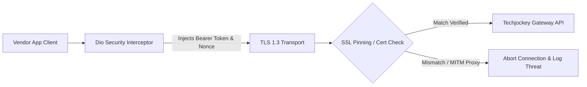

# Application Security & Hardening Guide: Techjockey Vendor App

## 1. Secure Storage Architecture

The legacy project relied on unencrypted `SharedPreferences` for storing authorization bearer tokens and user credentials. In the modernized production architecture, all authentication tokens, session identifiers, and sensitive user profile fields are stored using **hardware-backed encrypted storage** via `flutter_secure_storage`.

### 1.1 Storage Implementation Details
* **Android**: Uses `EncryptedSharedPreferences` backed by the Android Hardware KeyStore (AES-256 GCM master key).
* **iOS**: Leverages the Apple Keychain with `kSecAttrAccessibleAfterFirstUnlockThisDeviceOnly` access control.

```dart
// lib/core/services/secure_storage_service.dart
import 'package:flutter_secure_storage/flutter_secure_storage.dart';
import 'package:get/get.dart';

class SecureStorageService extends GetxService {
  late final FlutterSecureStorage _storage;

  Future<SecureStorageService> init() async {
    _storage = const FlutterSecureStorage(
      aOptions: AndroidOptions(
        encryptedSharedPreferences: true,
        resetOnError: true,
      ),
      iOptions: IOSOptions(
        accessibility: KeychainAccessibility.first_unlock_this_device,
      ),
    );
    return this;
  }

  // Token Management
  Future<void> saveAuthToken(String token) async =>
      await _storage.write(key: 'jwt_auth_token', value: token);

  Future<String?> getAuthToken() async =>
      await _storage.read(key: 'jwt_auth_token');

  Future<void> clearSession() async =>
      await _storage.deleteAll();
}
```

---

## 2. Network Security & API Protection



### 2.1 Transport Layer Security & SSL Pinning
All outgoing traffic is restricted to HTTPS over TLS 1.3. For production builds, critical endpoints implement certificate public key pinning to eliminate Man-In-The-Middle (MITM) attacks.

```dart
// lib/core/network/ssl_pinning_client.dart
import 'dart:io';
import 'package:dio/dio.dart';
import 'package:dio/io.dart';

void setupSecurityPinning(Dio dio) {
  const allowedFingerprint = 'A1:B2:C3:D4:E5:F6:...PROD_SHA256_FINGERPRINT...';

  dio.httpClientAdapter = IOHttpClientAdapter(
    createHttpClient: () {
      final SecurityContext context = SecurityContext(withTrustedRoots: true);
      final HttpClient client = HttpClient(context: context);
      
      client.badCertificateCallback = (X509Certificate cert, String host, int port) {
        // Enforce exact SHA-256 fingerprint verification
        return cert.sha256.map((b) => b.toRadixString(16).padLeft(2, '0')).join(':').toUpperCase() == allowedFingerprint;
      };
      
      return client;
    },
  );
}
```

### 2.2 Dio Auth & Sanitization Interceptors
* **Token Injection**: Automatically attaches `Authorization: Bearer <token>` to outbound requests.
* **Sensitive Payload Masking**: Prevents logging of passwords, credit cards, or buyer phone numbers in release builds.

```dart
// lib/core/network/auth_interceptor.dart
import 'package:dio/dio.dart';
import '../services/secure_storage_service.dart';

class AuthInterceptor extends QueuedInterceptor {
  final SecureStorageService _storage;
  AuthInterceptor(this._storage);

  @override
  void onRequest(RequestOptions options, RequestInterceptorHandler handler) async {
    final token = await _storage.getAuthToken();
    if (token != null && token.isNotEmpty) {
      options.headers['Authorization'] = 'Bearer $token';
    }
    options.headers['Accept'] = 'application/json';
    return handler.next(options);
  }

  @override
  void onError(DioException err, ErrorInterceptorHandler handler) {
    if (err.response?.statusCode == 401) {
      // Trigger automatic session expiration & route to login
      _storage.clearSession();
    }
    return handler.next(err);
  }
}
```

---

## 3. Application Hardening & Device Integrity

### 3.1 Screen Privacy on App Backgrounding
To protect sensitive commercial lead records and buyer contact information from appearing in system app switchers, screen obfuscation is enabled whenever the app is sent to the background.

```dart
// lib/core/services/privacy_screen_service.dart
import 'package:flutter/material.dart';

class PrivacyScreenService with WidgetsBindingObserver {
  OverlayEntry? _privacyOverlay;

  void init() {
    WidgetsBinding.instance.addObserver(this);
  }

  @override
  void didChangeAppLifecycleState(AppLifecycleState state) {
    if (state == AppLifecycleState.inactive || state == AppLifecycleState.paused) {
      _showPrivacyOverlay();
    } else if (state == AppLifecycleState.resumed) {
      _hidePrivacyOverlay();
    }
  }

  void _showPrivacyOverlay() {
    // Inserts a solid branded color barrier over the window root
  }

  void _hidePrivacyOverlay() {
    _privacyOverlay?.remove();
    _privacyOverlay = null;
  }
}
```

### 3.2 Root and Jailbreak Detection
Devices operating under rooted or jailbroken configurations pose security risks for B2B buyer lead data exfiltration. The app evaluates device integrity before granting session access:

```dart
// lib/core/utils/device_integrity_checker.dart
import 'package:flutter_jailbreak_detection/flutter_jailbreak_detection.dart';

class DeviceIntegrityChecker {
  static Future<bool> isDeviceCompromised() async {
    final bool jailbroken = await FlutterJailbreakDetection.jailbroken;
    final bool developerMode = await FlutterJailbreakDetection.developerMode;
    return jailbroken;
  }
}
```

---

## 4. Third-Party SDK Governance

| SDK Name | Vendor | Data Collected | Justification | Privacy Compliance |
| :--- | :--- | :--- | :--- | :--- |
| **Firebase Crashlytics** | Google | Stack traces, device model, OS version | Automated crash triage and stability tracking. | No PII; strictly anonymized runtime logs. |
| **Firebase Analytics** | Google | Screen views, session duration, lead view events | Product analytics and funnel completion monitoring. | Vendor ID pseudonymized. |
| **MoEngage** | MoEngage Inc. | Device token, push open rates, in-app impressions | Campaign engagement, lead alerts, rich notifications. | Opt-out mechanism implemented. |
| **Huawei Push Kit** | Huawei | Push registration token | Delivering push alerts to Huawei HarmonyOS devices without GMS. | Compliant with Huawei HMS privacy policy. |

---

## 5. Vulnerability Disclosure & Incident Response

### 5.1 Severity Matrix & SLA

| Severity | Definition | Examples | Response SLA | Target Resolution |
| :--- | :--- | :--- | :--- | :--- |
| **Critical** | Direct data breach, token compromise, RCE | Authentication bypass, plaintext token leakage in logs | 2 Hours | 24 Hours |
| **High** | Lead data leakage, unauthorized order updates | Missing authorization check on lead endpoints | 4 Hours | 48 Hours |
| **Medium** | Minor information leakage, denial of service | Crash on malformed deep link, verbose debug logs | 24 Hours | 5 Business Days |
| **Low** | Code style issues, UI disclosure | Minor text truncation, missing header warning | 48 Hours | Next Scheduled Release |

### 5.2 Incident Escalation Protocol
1. **Reporting**: Immediate submission to `security@techjockey.com`.
2. **Containment**: Revoke compromised API keys and deploy Remote Config `is_maintenance_mode = true` if widespread exploitation is detected.
3. **Remediation**: Hotfix deployed through CI/CD pipeline and emergency App Store / Google Play submission with accelerated review requests.
4. **Post-Mortem**: Root Cause Analysis (RCA) documented and published within 5 business days.

