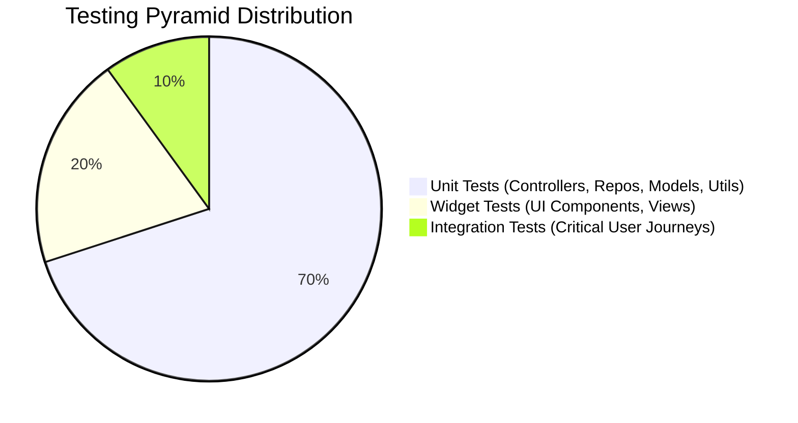

# Testing Strategy & Quality Assurance Guide: Techjockey Vendor App

## 1. Testing Pyramid & Coverage Targets

Quality assurance in the Techjockey Vendor App follows a structured **Testing Pyramid**, biasing heavily toward fast, deterministic unit tests while reserving end-to-end integration tests for critical business workflows.



### 1.1 Target Coverage Metrics

| Layer | Focus Areas | Target Coverage | Execution Frequency |
| :--- | :--- | :--- | :--- |
| **Unit Tests** | `GetxController` state machines, Repositories, Model serialization, Utility classes | **>= 80%** | Every PR commit (pre-merge) |
| **Widget Tests** | Presentation state transitions (Loading -> Content -> Error), UI components, forms | **>= 60%** | Every PR commit |
| **Integration Tests** | Login -> Lead detail -> Accept demo -> Order license upload flows | Top 5 User Flows | Nightly build & Pre-release |

---

## 2. Directory Layout & Test Conventions

```
test/
├── unit/
│   ├── controllers/            # GetxController test suites
│   │   ├── auth_controller_test.dart
│   │   ├── lead_controller_test.dart
│   │   └── order_tracking_controller_test.dart
│   ├── repositories/           # Data layer & API mapping tests
│   │   ├── lead_repository_test.dart
│   │   └── order_repository_test.dart
│   ├── models/                 # Serialization & parsing tests
│   │   └── lead_model_test.dart
│   └── utils/                  # Date helpers, formatters, sanitizers
├── widget/
│   ├── components/             # Atomic widgets (LeadCard, Badges, Modals)
│   │   └── lead_card_widget_test.dart
│   └── views/                  # Screen-level widget tests
│       └── login_view_test.dart
├── mocks/                      # Reusable Mocktail classes & fixtures
│   ├── mock_api_client.dart
│   ├── mock_repositories.dart
│   └── fixtures/
│       ├── lead_list_fixture.json
│       └── order_details_fixture.json
└── test_helpers/               # GetX test wrapper utilities
    └── getx_test_wrapper.dart
```

---

## 3. Mocking Standards & Test Infrastructure

The codebase uses **`mocktail`** for zero-boilerplate, null-safe mocking without code generation steps.

### 3.1 Defining Test Mocks

```dart
// test/mocks/mock_repositories.dart
import 'package:mocktail/mocktail.dart';
import 'package:vendor_app/features/leads/repositories/lead_repository.dart';
import 'package:vendor_app/core/network/api_client.dart';

class MockLeadRepository extends Mock implements LeadRepository {}
class MockApiClient extends Mock implements ApiClient {}
```

### 3.2 Unit Testing a GetX Controller

```dart
// test/unit/controllers/lead_controller_test.dart
import 'package:flutter_test/flutter_test.dart';
import 'package:get/get.dart';
import 'package:mocktail/mocktail.dart';
import 'package:vendor_app/features/leads/controllers/lead_controller.dart';
import 'package:vendor_app/features/leads/models/lead_model.dart';
import '../../mocks/mock_repositories.dart';

void main() {
  late LeadController controller;
  late MockLeadRepository mockRepository;

  final sampleLeads = [
    LeadModel(
      id: '101',
      buyerName: 'Enterprise Buyer',
      companyName: 'Acme Corp',
      contactNumber: '9999999999',
      email: 'buyer@acme.com',
      status: 'HOT',
      dealValue: 50000.0,
      createdAt: DateTime.now(),
    ),
  ];

  setUp(() {
    Get.testMode = true; // Enables deterministic GetX testing
    mockRepository = MockLeadRepository();
    controller = LeadController(mockRepository);
  });

  tearDown(() {
    Get.reset();
  });

  group('LeadController Unit Tests', () {
    test('Initial state should have empty leads and false isLoading', () {
      expect(controller.leads.isEmpty, isTrue);
      expect(controller.isLoading.value, isFalse);
    });

    test('fetchLeads() should populate leads and toggle loading states', () async {
      // Arrange
      when(() => mockRepository.getLeads(status: any(named: 'status'), query: any(named: 'query')))
          .thenAnswer((_) async => sampleLeads);

      // Act
      final future = controller.fetchLeads();
      expect(controller.isLoading.value, isTrue);

      await future;

      // Assert
      expect(controller.isLoading.value, isFalse);
      expect(controller.leads.length, equals(1));
      expect(controller.leads.first.buyerName, equals('Enterprise Buyer'));
      verify(() => mockRepository.getLeads(status: any(named: 'status'), query: any(named: 'query'))).called(1);
    });
  });
}
```

### 3.3 Widget Testing a Presentation Component

```dart
// test/widget/components/lead_card_widget_test.dart
import 'package:flutter/material.dart';
import 'package:flutter_test/flutter_test.dart';
import 'package:vendor_app/features/leads/widgets/lead_card_widget.dart';
import 'package:vendor_app/features/leads/models/lead_model.dart';

void main() {
  testWidgets('LeadCardWidget renders buyer details and handles tap', (tester) async {
    bool tapped = false;
    final lead = LeadModel(
      id: '123',
      buyerName: 'Rahul Sharma',
      companyName: 'Tech Innovators Ltd',
      contactNumber: '9876543210',
      email: 'rahul@innovators.in',
      status: 'HOT',
      dealValue: 120000.0,
      createdAt: DateTime(2026, 1, 15),
    );

    await tester.pumpWidget(
      MaterialApp(
        home: Scaffold(
          body: LeadCardWidget(
            lead: lead,
            onTap: () => tapped = true,
          ),
        ),
      ),
    );

    // Verify buyer name and company render
    expect(find.text('Rahul Sharma'), findsOneWidget);
    expect(find.text('Tech Innovators Ltd'), findsOneWidget);

    // Verify tap callback
    await tester.tap(find.byType(InkWell));
    await tester.pumpAndSettle();
    expect(tapped, isTrue);
  });
}
```

---

## 4. End-to-End Integration Testing

Integration tests run real user journeys using `integration_test` across emulators or physical testing devices.

```dart
// integration_test/app_flow_test.dart
import 'package:flutter_test/flutter_test.dart';
import 'package:integration_test/integration_test.dart';
import 'package:vendor_app/main.dart' as app;

void main() {
  IntegrationTestWidgetsFlutterBinding.ensureInitialized();

  testWidgets('Complete Login to Lead Inspection Journey', (tester) async {
    app.main();
    await tester.pumpAndSettle();

    // Verify Splash transitions to Login
    final emailField = find.byKey(const ValueKey('login_email_input'));
    final passwordField = find.byKey(const ValueKey('login_password_input'));
    final loginButton = find.byKey(const ValueKey('login_submit_button'));

    expect(emailField, findsOneWidget);

    // Fill credentials
    await tester.enterText(emailField, 'vendor@techjockey.com');
    await tester.enterText(passwordField, 'Password@123');
    await tester.tap(loginButton);
    await tester.pumpAndSettle();

    // Verify Landing on Dashboard
    expect(find.text('Deal Opportunities & Leads'), findsOneWidget);
  });
}
```

---

## 5. CLI Execution & Coverage Reporting Commands

### 5.1 Run All Unit & Widget Tests
```bash
# Run tests with coverage output
flutter test --coverage

# Run a specific test suite
flutter test test/unit/controllers/lead_controller_test.dart
```

### 5.2 Generate HTML Coverage Report (lcov)
Ensure `lcov` is installed (`brew install lcov` on macOS or `apt-get install lcov` on Linux):

```bash
# Filter out generated files and models from coverage if desired
lcov --remove coverage/lcov.info 'lib/**/*.g.dart' 'lib/routes/*' -o coverage/filtered.info

# Generate human-readable HTML report
genhtml coverage/filtered.info -o coverage/html

# Open report in default browser (macOS)
open coverage/html/index.html
```

### 5.3 Run Integration Tests on Connected Devices
```bash
# List available simulators and devices
flutter devices

# Run integration test on connected Android/iOS device
flutter test integration_test/app_flow_test.dart -d <DEVICE_ID>
```

